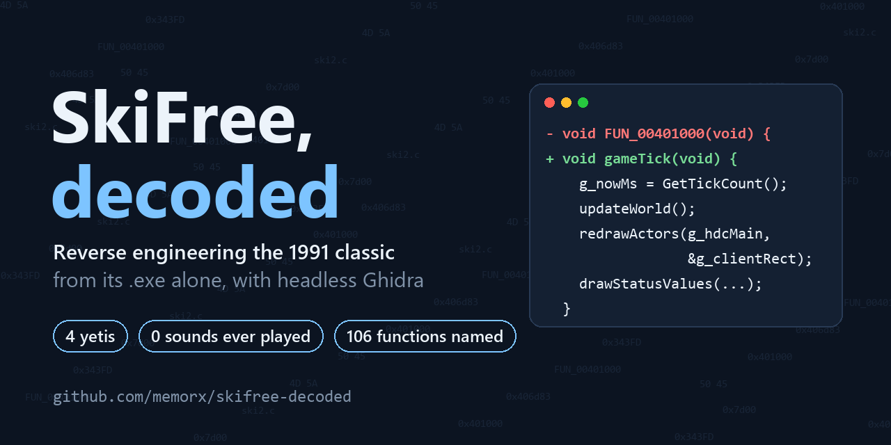
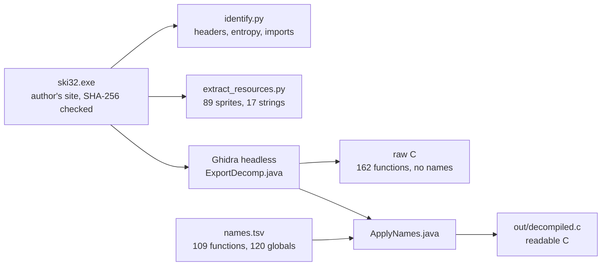

# SkiFree, decoded



**Reverse engineering the 1991 Windows classic from its `.exe` alone.** One command turns the original 118 KB executable into readable C with every game function named. The docs teach you to do the same to any old Windows program.

  

*En español: [guía de aprendizaje](docs/APRENDE.md).*

## What was hiding in the binary

Everyone knows the yeti gets you after 2,000 meters and that F makes you go fast. Reading the code turned up more:

- **SkiFree has never made a sound.** The code to play 9 sound effects is all there, with a `nosound` switch. The sounds themselves were never put in the file.
- **There are four yetis, not one.** One waits at each edge of the world. Ski 125 m uphill or 1,000 m to either side and you meet the others.
- **Click to jump.** A mouse-click jump goes three times as high as the keyboard jump, and it doesn't slow you down.
- **The dog pees.** Bump into it and it stops to bark; about 1 time in 4 it leaves yellow snow. Skiing through it costs you 16 style points.
- **Trees catch fire.** Crash into a dead tree mid-jump and it bursts into flames. Jump over the fire for 1,000 points.
- **Stumps turn into mushrooms, and some trees walk.** On the open slope, 1 in 20 random objects is a pine that will eventually stroll away.
- **A penalty that never fires.** Botched landings were meant to cost 64 points; a table makes that branch unreachable.
- **Debug keys shipped.** `t` advances one frame, `r` redraws, `x` and `y` nudge the skier.
- **The author left his asserts in.** Every one prints the same source file, `V:\hack\ski32\ski2.c`, with line numbers up to 4,387.

Each claim points to the function that proves it: see [what we found](docs/LEARN.md#what-we-found-inside-skifree) and the full [internals](docs/INTERNALS.md).

## Run it yourself

You need Python 3.9+, and for the decompilation [Ghidra](https://ghidra-sre.org/) 12.x with Java 21.

```bash
pip install -r requirements.txt
export GHIDRA_HOME=/path/to/ghidra_12.1.2_PUBLIC     # Windows: set GHIDRA_HOME=C:\path\to\ghidra_12.1.2_PUBLIC
python run.py
```

`run.py` downloads `ski32.exe` from [the author's own site](https://ski.ihoc.net/), refuses to continue unless its SHA-256 matches, and then rebuilds everything in `out/`. The Ghidra analysis takes a few minutes.

| Output | What it is |
| --- | --- |
| `out/decompiled.c` | The game's 106 functions as readable C, with names |
| `out/functions.tsv` | Every function with its address, size and call counts |
| `out/identify.txt` | PE headers, sections and entropy, imports, Rich header |
| `out/sprites/contact_sheet.png` | All 89 sprites on one numbered sheet |
| `out/tables.txt` | The data tables that drive animation, steering and physics |
| `out/raw_decompiled.c` | Ghidra's unnamed output, to compare against |

No Ghidra? `python run.py --no-ghidra` runs the Python steps only. Edited `names.tsv`? `python run.py --names-only` re-applies it in seconds.

## How it works



The real work is [`names.tsv`](names.tsv): every function and global we identified by reading the decompiled code, as `kind, address, name`. Ghidra applies it, creates the two functions its auto-analysis missed (the window procedure and the timer callback are only ever referenced through pointers), and exports the result.

## Learn to do this

The guide walks through every step with what we did, why it works, and something to try. It assumes you can read C and have never opened a disassembler.

- **[LEARN.md](docs/LEARN.md)**: the learning guide in English.
- **[APRENDE.md](docs/APRENDE.md)**: la misma guía en español.
- **[INTERNALS.md](docs/INTERNALS.md)**: how SkiFree works inside: the object struct, all 18 object types, courses, yetis, controls, scoring.

It also lists the mistakes we made along the way and what each one teaches, plus exercises from "run it on notepad.exe" to "make the yeti come at 500 m".

## Repository layout

```
run.py                  one command for everything
names.tsv               the names: the actual reverse engineering
scripts/
  identify.py           step 1: headers, entropy, imports, strings
  extract_resources.py  step 1b: string table, bitmaps, contact sheet
  dump_tables.py        step 3 helper: the game's data tables
ghidra/
  ExportDecomp.java     step 2: export raw decompiled C and cross-references
  ApplyNames.java       step 3: apply names.tsv and export the named C
docs/
  LEARN.md  APRENDE.md  INTERNALS.md
```

## How this was made

The analysis was done with [Claude Code](https://claude.com/claude-code), Anthropic's AI coding agent, directed by [@memorx](https://github.com/memorx). Ghidra ran headless so the agent could drive it, and every claim about the game was re-checked against the decompiled code before it went into the docs.

## Credits and legal

- **SkiFree** is © Chris Pirih, who distributes it for free at [ski.ihoc.net](https://ski.ihoc.net/). The game binary and anything extracted from it are not included in this repository; `run.py` downloads it from his site.
- **[skifree_decomp](https://github.com/yuv422/skifree_decomp)** by Eric Fry is a decompilation of the same executable that aims to be byte-compatible with the original. We used it only as an answer key after finishing our own reading. None of its code is included.
- This project is not affiliated with Chris Pirih or Microsoft.
- The scripts and documentation here are released under the [MIT License](LICENSE).
