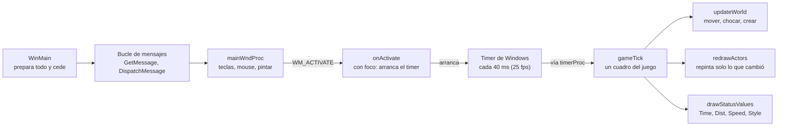

# Reverse engineering de SkiFree: guía de aprendizaje

*Read in English: [LEARN.md](LEARN.md)*

## Cómo usar esta guía

Esta guía lleva el ejecutable de SkiFree, de 118 KB, desde los bytes crudos hasta C legible con cada función del juego nombrada. Y enseña el método, para que lo repitas con cualquier programa viejo de Windows.

Está escrita para programadores que leen C pero nunca han abierto un desensamblador. No necesitas saber ensamblador: esa parte la hace el decompilador, y tu trabajo es recuperar el significado.

Al terminar vas a poder:

1. Identificar un `.exe` desconocido: compilador, fecha, si está empacado, qué le pide a Windows.
2. Sacar sus textos, imágenes y tablas a archivos normales.
3. Correr Ghidra desde la línea de comandos y exportar el C decompilado.
4. Leer ese C, nombrar cada función y variable global, y documentar cómo funciona el programa.
5. Verificar tu lectura contra una fuente independiente y cazar tus propios errores.

Cada paso tiene tres partes: qué hicimos, por qué funciona y algo para que lo intentes tú. Los scripts están en este repositorio, y `python run.py` reproduce todo. El funcionamiento interno del juego está documentado, en inglés, en [INTERNALS.md](INTERNALS.md).

El análisis se hizo con Claude Code, un agente de programación con IA, dirigido por el autor. Cada afirmación sobre el juego se volvió a comprobar contra el código decompilado antes de entrar a esta guía, y los errores que cometimos en el camino están en el Paso 4.

## El panorama general

Hacer reverse engineering es recuperar cómo funciona un programa a partir del programa compilado, sin el código fuente. Al compilar se pierden los nombres, los comentarios y los tipos, pero se quedan la lógica, las constantes, los textos y cada llamada que el programa le hace al sistema operativo. Tu trabajo es devolverle el significado.

Hay cuatro niveles para "revivir" software viejo, y cada uno cuesta mucho más que el anterior:

| Nivel | Qué se hace | Esfuerzo típico |
| --- | --- | --- |
| 1. Correrlo | Usar un emulador o capa de compatibilidad: DOSBox, Wine, modo de compatibilidad de Windows | Minutos |
| 2. Parchearlo | Cambiar unos bytes para saltar un chequeo de CD, de versión o un timer roto | Horas a días |
| 3. Entenderlo | Decompilar, nombrar todo y documentar cómo funciona | Días a semanas |
| 4. Reconstruirlo | Escribir C que compile exactamente a los mismos bytes, para poder portarlo | Meses |

Este proyecto es un nivel 3 completo. El nivel 4 es lo que hicieron los proyectos famosos de decompilación de Super Mario 64 y Diablo.

Cuatro filtros para escoger un buen objetivo:

- **Abandonado.** Nadie lo vende ni lo mantiene.
- **Que nadie lo haya hecho.** Busca en GitHub primero. Nosotros nos saltamos este paso y después descubrimos que SkiFree ya tenía una decompilación publicada.
- **Chico.** Un ejecutable de 200 KB a 2 MB se termina. Uno de 50 MB es un proyecto de años.
- **De 32 bits si se puede.** Windows 95 en adelante. Los decompiladores entienden muy bien el código de Windows de 32 bits; el de 16 bits y el de DOS cuestan como el doble en cada paso.

SkiFree pasa todos los filtros menos el segundo, y eso resultó útil: una decompilación publicada es una hoja de respuestas para comparar tu propia lectura, que es justo lo que necesita un primer proyecto.

## Paso 0: conseguir el binario legalmente, y fijarlo

El autor de SkiFree, Chris Pirih, regala el juego en su propio sitio, [ski.ihoc.net](https://ski.ihoc.net/). Usamos la versión de 32 bits 1.04, `ski32.exe`, de 118,784 bytes.

**Qué hicimos.** Lo bajamos del sitio del autor y anotamos su hash SHA-256:

```
3572d3757638bc1ae388c3d007ba59ba1f370911901e2a35d2f1297e8cf0ff35  ski32.exe
```

**Por qué importa.** Cada dirección de esta guía, como `0x401000` o `0x4052d0`, se refiere a ese archivo exacto. Otra compilación del mismo juego mueve todas las funciones y nada de aquí va a cuadrar. El hash es la forma en que tú, y cualquiera que repita tu trabajo, sabe que partió de los mismos bytes.

Dos reglas que mantienen limpio un proyecto así:

- **Nunca subas el binario a tu repositorio.** Pon la liga de donde se baja legalmente y verifica el hash. Nuestro `run.py` lo baja del sitio del autor y se niega a seguir si el hash no coincide.
- **Tampoco subas lo que extraes de él**, como los sprites. El repo publica el método y los nombres; lo demás lo regeneras en tu máquina.

**Inténtalo.** En Windows, `certutil -hashfile ski32.exe SHA256`. En Linux o macOS, `sha256sum ski32.exe`.

## Paso 1: identificar el ejecutable antes de desensamblarlo

Un `.exe` de Windows es un archivo PE (Portable Executable) y trae su propia ficha técnica en las cabeceras. Leerlas primero te dice en un minuto con qué estás tratando, antes de desensamblar nada. Script: [`scripts/identify.py`](../scripts/identify.py), con la librería de Python `pefile`.

**Lo que dijeron las cabeceras de SkiFree:**

| Campo | Valor | Qué te dice |
| --- | --- | --- |
| Máquina | i386 | Código Intel de 32 bits |
| Subsistema | GUI de Windows, sistema mínimo 4.0 | Un programa con ventana para Windows 95 en adelante |
| Fecha | 2 oct 2005, 22:01 UTC | Cuándo se enlazó; cuadra con lo que cuenta el autor de que lo recompiló en 2005 |
| Versión del linker | 6.0 | Visual C++ 6 |
| Image base / entry point | `0x400000` / `0x406d83` | Dónde se carga en memoria y dónde empieza a ejecutar |

**El Rich header.** El linker de Microsoft esconde, entre el stub de DOS y la cabecera PE, una lista no documentada de las herramientas que compilaron cada objeto. La de SkiFree dice: 27 objetos del compilador de C de Visual C++ 6, 1 del compilador de C++, 10 del ensamblador MASM, más el compilador de recursos. Conclusión: el juego está escrito en C, no en C++. Los objetos de C++ y de ensamblador son de la librería de C de Microsoft, que se enlaza en todo programa.

**Secciones y entropía.** Un ejecutable se divide en secciones. Medir la entropía de cada una te dice si está empacado o cifrado antes de perder un día en él:

$$H = -\sum_{i=0}^{255} p_i \log_2 p_i$$

Aquí p es qué tan seguido aparece cada valor de byte. El resultado va de 0 (un solo valor repetido) a 8 bits por byte (totalmente aleatorio). El código máquina normal anda entre 5 y 6.5. Arriba de 7 significa comprimido o cifrado, y hay que desempacarlo primero.

| Sección | Guarda | Tamaño | Entropía |
| --- | --- | --- | --- |
| `.text` | Código máquina | 34 KB | 6.29 |
| `.rdata` | Constantes y tabla de imports | 4 KB | 3.10 |
| `.data` | Variables globales | 3 KB | 1.36 |
| `.rsrc` | Recursos: imágenes, iconos, textos | 62 KB | 3.75 |

Nada está empacado. Y más de la mitad del archivo son dibujos: el programa en sí pesa 34 KB.

**Los imports cuentan la historia.** La tabla de imports lista cada función que el programa le pide prestada a Windows. Puedes describir el juego con ella sin leer una sola instrucción:

- `BitBlt`, `CreateCompatibleDC`, `CreateCompatibleBitmap`: dibuja con GDI puro, sin DirectX.
- `SetTimer`, `KillTimer`, `GetTickCount`: el reloj del juego es un timer de Windows.
- `GetPrivateProfileStringA`, `WritePrivateProfileStringA`: guarda algo en un archivo `.ini`. Muy probablemente los récords.
- `FindWindowA`, `OpenIcon`: seguramente evita que se abran dos copias.
- `LoadBitmapA`, `FindResourceA`, `LockResource`: los sprites salen de los recursos del propio archivo.
- `sndPlaySoundA`: una forma de tocar un sonido. Acuérdate de este.
- `HeapAlloc`, `GetEnvironmentStrings` y similares: la librería de C. Ruido que aprendes a ignorar.

**Inténtalo.** Corre `python scripts/identify.py` sobre otro programa, por ejemplo `C:\Windows\System32\notepad.exe`, y compara: ¿qué secciones, qué DLLs, qué entropía?

## Paso 1b: cadenas y recursos

Los textos y dibujos dentro del archivo son las pistas más baratas que vas a conseguir. Scripts: [`scripts/identify.py`](../scripts/identify.py) escribe todas las cadenas y [`scripts/extract_resources.py`](../scripts/extract_resources.py) escribe los recursos.

**Cadenas.** Buscar secuencias de 5 o más caracteres imprimibles, en ASCII y en UTF-16, encuentra 444. La mayoría son ruido, y reconocer el ruido es una habilidad:

- Basura corta como `L$ RPQ` es código máquina que por casualidad parece texto.
- Secuencias como `wwwwwwp` son píxeles de los bitmaps.
- `R6002 - floating point not loaded` y compañía son los mensajes de error de la librería de C.

Las que importan son pocas, y cada una es un ancla que vas a usar en el Paso 3:

- `SkiMain` y `SkiStatus`: nombres de clases de ventana. El juego tiene dos ventanas.
- `entpack.ini`: el archivo de configuración del viejo Windows Entertainment Pack. Aquí van los récords.
- `V:\hack\ski32\ski2.c` con `Assertion Failed` y `%s line %u`: el autor dejó sus chequeos de depuración. Cada uno imprime el nombre del archivo fuente original y el número de línea.
- `nosound`: una opción de línea de comandos.
- `Whoa, like, can't load bitmaps!  Yer outa memory, duuude!`: un mensaje de error con personalidad.

**Recursos.** Los programas de Windows guardan dibujos, iconos y textos traducibles en una sección de recursos, organizada por tipo y por número. SkiFree tiene cuatro tipos: 89 bitmaps, 6 iconos, 2 grupos de iconos y 2 tablas de textos.

- **Las tablas de textos** vienen en bloques de 16. El número de cada texto es `(bloque - 1) * 16 + posición`. Al decodificarlas salen 17 textos con su número: el 1 es `SkiFree`, el 2 es `Ski Paused ... Press F3 to continue`, del 3 al 6 son `Time:`, `Dist:`, `Speed:`, `Style:`, el 15 es `High Scores`. Los números importan, porque el código pide los textos por número.
- **Los bitmaps** se guardan como un BMP sin sus 14 bytes de cabecera de archivo. Vuelve a escribir esos 14 bytes y cada uno abre en cualquier visor de imágenes. Luego pon los 89 en una sola hoja numerada. Esa hoja contestó más preguntas en el Paso 3 que cualquier otra cosa.

Fíjate en lo que falta: no hay ningún recurso de sonido. Guárdalo hasta la sección de secretos.

**Inténtalo.** Corre `python scripts/extract_resources.py` y abre `out/sprites/contact_sheet.png`. Antes de leer código, adivina para qué son el bitmap 82 y los del 83 al 85.

## Paso 2: Ghidra sin interfaz

[Ghidra](https://ghidra-sre.org/) es el desensamblador y decompilador gratuito de la NSA. Casi todos los tutoriales usan su ventana; nosotros lo corrimos headless, desde la línea de comandos, para que cada resultado quede en un archivo de texto que puedes buscar, comparar y guardar en git.

**Qué hicimos.** Una llamada a `analyzeHeadless` de Ghidra importa `ski32.exe` a un proyecto, corre todos los analizadores automáticos y luego ejecuta nuestro script [`ghidra/ExportDecomp.java`](../ghidra/ExportDecomp.java). El script escribe tres archivos:

- `out/raw_decompiled.c`: el C que Ghidra reconstruye para cada función.
- `out/raw_functions.tsv`: cada función con su dirección, tamaño, cuántas funciones la llaman y a cuántas llama.
- `out/strings_xref.tsv`: cada texto y qué funciones lo usan.

**Lo que el análisis automático hace por ti:**

1. Empieza en el entry point y sigue cada salto y cada llamada para separar el código de los datos.
2. Encuentra dónde empieza y termina cada función y arma el grafo de llamadas.
3. Reconoce las funciones de la librería de C por su firma de bytes, así que `malloc`, `strlen` y `memset` llegan con nombre.
4. Aplica las cabeceras de Win32: por eso la llamada a `CreateWindowExA` llega con sus parámetros nombrados `lpWindowName`, `dwStyle`, etc.

**El resultado para SkiFree:** 162 funciones, todas decompiladas sin una sola falla, y casi todas llamadas `FUN_00401060` con variables como `iVar3`. Esa es la materia prima del Paso 3.

**Dónde termina el juego y empieza la librería.** El linker pone primero el código del programa y después el de la librería. Las funciones propias de SkiFree van de `0x401000` a `0x406c80`: 104 que encontró Ghidra más 2 que encontramos a mano en el Paso 3. De `0x406cd0` en adelante es la librería de C de Microsoft: `srand`, `rand`, `atoi` y luego el código de arranque en el entry point, que en algún momento llama a `WinMain`. Puedes reconocer `rand` sin ninguna firma: multiplica por `0x343FD` y suma `0x269EC3`, las constantes del generador de números aleatorios de Microsoft. Constantes mágicas como estas identifican código de librería a simple vista.

**Por qué vale la pena hacerlo headless.** Todo el proceso se vuelve un solo comando que cualquiera puede repetir desde cero. También permite que un script, un job de CI o un agente de IA maneje Ghidra, que es como se hizo este proyecto.

**Inténtalo.** Instala Ghidra y Java 21, define `GHIDRA_HOME` y corre `python run.py`. Luego abre `out/raw_functions.tsv` y ordénalo por la columna de llamadores: ¿qué funciones se llaman más, y cuáles nunca las llama nadie?

## Paso 3: leer el código decompilado y ponerle nombres

Este es el reverse engineering de verdad: convertir 106 funciones llamadas `FUN_...` en un programa que entiendes. El truco es nunca empezar por en medio. Trabaja de afuera hacia adentro, con las pistas que ya tienes, y nombra cada función en cuanto la entiendas.

Así se ve una función antes y después. Es el mismo código; solo cambiaron los nombres:

```c
// Antes: tal como sale de Ghidra
void FUN_00401000(void) {
  DWORD DVar1 = GetTickCount();
  DAT_0040c5f4 = DVar1 - DAT_0040c698;
  DAT_0040c708 = DAT_0040c698;
  DAT_0040c698 = DVar1;
  FUN_00401e50();
  FUN_00401060(DAT_0040c63c, &DAT_0040c6b0);
  DAT_0040c610 = 1;
  if (0x147 < (int)(DAT_0040c698 - DAT_0040c5dc)) FUN_00401b80(DAT_0040c6cc);
}

// Después: con nuestros nombres
void gameTick(void) {
  DWORD DVar1 = GetTickCount();
  g_frameMs = DVar1 - g_nowMs;
  g_prevMs = g_nowMs;
  g_nowMs = DVar1;
  updateWorld();
  redrawActors(g_hdcMain, &g_clientRect);
  g_redrawBudget = 1;
  if (0x147 < (int)(g_nowMs - g_statusDrawnMs)) drawStatusValues(g_hdcStatus);
}
```

El orden que funcionó, de la pista más fácil a la más difícil:

1. **Anclas de textos.** `out/strings_xref.tsv` dice qué función usa cada texto. La que usa `SkiMain` y `SkiStatus` registra las ventanas: `initWindows`. La que usa `entpack.ini` guarda los récords: `showHighScores`. La que arma `%s line %u` y muestra `Assertion Failed` es el `assert` del autor, y las 45 funciones que la llaman son todas código del juego.
2. **Anclas de imports.** La función que llama a `SetTimer` arranca el reloj. La que llama a `BitBlt` dentro de un ciclo sobre 89 bitmaps carga los sprites. La que llama a `GetTickCount` y luego a dos funciones grandes es el tick del juego, el de arriba.
3. **Los números de mensajes de Windows.** Un window procedure es un `switch` gigante sobre números de mensaje. Apréndete los comunes y nombras todos los manejadores de un jalón:

    | Número | Mensaje | Manejador en SkiFree |
    | --- | --- | --- |
    | `0x0001` | `WM_CREATE` | `initGraphics` |
    | `0x0005` | `WM_SIZE` | `onMainSize` |
    | `0x000F` | `WM_PAINT` | `onMainPaint` |
    | `0x0100` | `WM_KEYDOWN` | `onKeyDown` |
    | `0x0102` | `WM_CHAR` | `onCharKey` |
    | `0x0200` | `WM_MOUSEMOVE` | `onMouseMove` |
    | `0x0201` | `WM_LBUTTONDOWN` | `onLeftClick` |

    Dentro de `onKeyDown` funciona el mismo truco con los códigos de tecla virtual: `0x25` a `0x28` son las flechas, `0x60` a `0x69` el teclado numérico, `0x71` es F2 y `0x72` es F3.
4. **Las funciones que nadie llama.** Ordena por llamadores. Una función con cero llamadores la invoca Windows por medio de un puntero: un window procedure, el callback de un timer. Dos de las funciones más importantes de SkiFree, el window procedure principal en `0x405800` y el callback del timer en `0x4047c0`, ni siquiera se detectaron como funciones, porque el código solo guarda su dirección. Las creamos a mano. Revísalo siempre.
5. **Tablas de datos.** Mucho del comportamiento de un juego vive en tablas, no en código. [`scripts/dump_tables.py`](../scripts/dump_tables.py) las imprime: qué bitmap usa cada estado de animación, qué estado sigue al apretar izquierda o derecha, la velocidad máxima de cada estado. Sin las tablas no puedes saber que el objeto tipo 10 es un árbol.
6. **La hoja de sprites.** Cuando el código decía "crea un objeto tipo 0x11 con el bitmap 82", la hoja decía que el bitmap 82 es nieve amarilla. Las imágenes resuelven lo que el código solo no puede.
7. **Estructuras a partir de offsets.** Las mismas expresiones aparecen una y otra vez: `*(short *)(p + 0x40)`, `*(uint *)(p + 0x4c)`. Es una estructura leída campo por campo. Junta los offsets, deduce cada campo por cómo se usa y escribe la estructura:

    | Offset | Campo | Qué es |
    | --- | --- | --- |
    | `0x00` | next | Siguiente objeto de la lista |
    | `0x04` | ghost | Copia en la posición anterior, para borrar |
    | `0x10` | bitmap | Número de sprite, del 1 al 89 |
    | `0x18` | type | Esquiador, perro, yeti, árbol, etc. |
    | `0x1c` | state | Estado de animación, del 0 al 63 |
    | `0x40` | x, y, z | Posición en el mundo; z es la altura al saltar |
    | `0x46` | vx, vy, vz | Velocidad |
    | `0x4c` | flags | Dibujado, fantasma, borrado, redibujar, calcomanía de piso |

**El ciclo de nombres.** Los nombres van en [`names.tsv`](../names.tsv), tres columnas: `fn`, `dat` o `create`, luego la dirección y luego el nombre. [`ghidra/ApplyNames.java`](../ghidra/ApplyNames.java) los aplica sobre el proyecto analizado, crea las funciones que falten y vuelve a exportar `out/decompiled.c`. Cada pasada facilita la siguiente, porque cada nombre que agregas vuelve legible el código de alrededor. Terminamos con 109 funciones nombradas (106 del juego y 3 de la librería) y 120 variables globales.



El mapa con el que terminas. `WinMain` prepara todo y le pasa el control a Windows. A partir de ahí un timer de 40 ms corre un cuadro del juego por tick, y solo corre mientras la ventana tiene el foco: cambia a otro programa y el juego se pausa solo.

**Inténtalo.** Escoge una función que todavía no tenga nombre en `out/decompiled.c`, léela y escribe su nombre en `names.tsv`. Corre `python run.py --names-only` y mira cómo se propaga a cada función que la llama.

## Paso 4: verificar tu lectura y aprender de los errores

Solo después de poner todos los nombres abrimos la hoja de respuestas: [skifree_decomp](https://github.com/yuv422/skifree_decomp) de Eric Fry, una decompilación del mismo `ski32.exe` publicada en septiembre de 2022. Mirarla antes habría convertido el ejercicio en copiar.

**Qué coincidió.** Los 18 tipos de objeto, del 0 al 17, coinciden uno por uno con los suyos y en el mismo orden: jugador, principiante, perro, snowboarder, telesilla, cuatro yetis, árbol en llamas, árbol que camina, montículos, bandera de slalom, árbol, roca o tronco, bulto, rampa, letrero. Varios nombres de función salieron idénticos sin haber visto los suyos. En las funciones que comparamos, las dos lecturas coinciden.

| Dirección | Nuestro nombre | El suyo | Nota |
| --- | --- | --- | --- |
| `0x4052d0` | `initWindows` | `initWindows` | Idéntico |
| `0x401240` | `assertFailed` | `assertFailed` | Idéntico |
| `0x401000` | `gameTick` | `timerUpdateFunc` | Misma idea |
| `0x403a00` | `handleCollision` | `handleActorCollision` | Misma idea |
| `0x401350` | `deleteActor` | `actorSetFlag8IfFlag1IsUnset` | Él nombra el mecanismo, nosotros la intención |
| `0x403430` | `applyPhysics` | `updateActorVelMaybe` | Él marca la duda con "Maybe" |
| `0x402e30` | `lerpAtLine` | `FUN_00402e30` | Él la dejó sin nombre |
| `0x4046e0` | `spawnVisible` | `FUN_004046e0` | Él la dejó sin nombre |

Los dos estilos son válidos. Nombrar el mecanismo es más seguro cuando tienes dudas; nombrar la intención se lee mejor cuando ya estás seguro.

**Los errores que cometimos y lo que enseña cada uno.** Ninguno lo detectó la referencia. Todos se detectaron al regresar al código con una afirmación concreta en la mano.

1. **Escogimos el objetivo sin buscar en GitHub.** SkiFree ya se había decompilado años antes. Lección: el filtro de "que nadie lo haya hecho" es una búsqueda, no una corazonada.
2. **Calculamos offsets del archivo a mano.** La primera versión del volcado de tablas supuso dónde empieza `.rdata` en el archivo, se equivocó e imprimió código máquina como si fueran tablas. Lección: deja que `pefile` convierta direcciones a offsets (`get_offset_from_rva`). Nunca hagas esa cuenta tú.
3. **Leímos de más lo del perro.** El primer borrador decía que el perro se detiene al azar y hace pipí el 1% de las veces. Al releer la máquina de estados se vio que solo se detiene después de que lo golpeas, y que el 1% aplica en cada ladrido, lo que da como una probabilidad en cuatro por cada golpe. Lección: una probabilidad en el código es por tick o por evento; calcula qué significa para el jugador antes de escribirla.
4. **Leímos de más lo del árbol en llamas.** Primero escribimos que chocar con un árbol seco lo incendia. La condición es más estricta: solo si lo golpeas a medio salto. Lección: lee todas las ramas del `if`, no solo la primera.
5. **Escribimos una fecha de memoria.** Dijimos que la referencia era de 2023. GitHub dice septiembre de 2022. Lección: cada fecha y cada número se verifica en su fuente.
6. **Pusimos el límite del código demasiado lejos.** Primero dijimos que el código del juego llegaba hasta `0x406cf8`. Las últimas tres funciones antes del entry point son `srand`, `rand` y `atoi` de la librería. Lección: las constantes mágicas son la forma más rápida de reconocer código de librería.

La regla general: escribe la afirmación y luego busca la línea exacta de código que la demuestra. Si no puedes señalar la línea, es una suposición y se queda fuera del documento.

## Lo que encontramos dentro de SkiFree

Los datos famosos se sostienen: el yeti te persigue después de 2,000 metros y la tecla F duplica tu velocidad. El código también muestra cosas que casi ningún jugador supo. Cada fila se verificó contra la función decompilada de la última columna. El detalle completo, en inglés, está en [INTERNALS.md](INTERNALS.md).

| Qué | Lo que de verdad hace el código | Función |
| --- | --- | --- |
| El juego es mudo, a propósito o por accidente | Hay un sistema de sonido completo con 9 sonidos y una opción `nosound`, pero el cargador busca recursos `WAVE` y el archivo no tiene ninguno. Nunca ha sonado nada. | `initWindows`, `loadWave` |
| Hay cuatro yetis, no uno | Uno espera en cada orilla del mundo. Baja 2,000 m, sube 125 m sobre la salida o aléjate 1,000 m a cualquier lado, y el yeti de esa orilla te persigue. | `buildCourses`, `updateYeti` |
| Los saltos con mouse llegan tres veces más alto | Un clic despega con velocidad hacia arriba de 4. La tecla Insert despega con 2 y además te quita 4 de velocidad hacia adelante. Con gravedad de 1 por tick, el clic llega a altura 10 en vez de 3 y dura en el aire como el doble. | `onLeftClick`, `onKeyDown` |
| La F duplica tu velocidad | La tecla F prende una bandera que aplica la velocidad dos veces por tick al esquiador y a todo objeto que se mueve libre. Los yetis y el telesilla corren en otro código y conservan su velocidad normal. | `onCharKey`, `applyVelocity` |
| El perro | Choca con el perro y se detiene a ladrar. Cada ladrido tiene 1% de probabilidad de que haga pipí y deje nieve amarilla (bitmap 82) antes de irse corriendo: como una en cuatro por golpe. Pasar por la nieve amarilla te quita 16 puntos de estilo. | `updateDog`, `handleCollision` |
| Los árboles se incendian | Choca con un árbol seco a medio salto y se prende en llamas. Salta sobre el árbol en llamas y ganas 1,000 puntos de estilo, y el fuego se apaga. | `handleCollision`, `updateFire` |
| Los troncos se vuelven hongos | Camina cuesta arriba contra un tronco: te caes igual, pero se convierte en hongo. Salta sobre el hongo y ganas 100 puntos de estilo. | `handleCollision` |
| Algunos árboles caminan | 1 de cada 20 objetos al azar en la pista abierta se ve igualito a un pino, hasta que empieza a caminar de lado. | `pickTypeOpenSlope`, `updateWalkingTree` |
| Un castigo que nunca se aplica | El código de aterrizaje resta 64 puntos por un aterrizaje fallido, pero la tabla de aterrizajes nunca produce ese estado. Código muerto. | `updateActor` |
| Puntos groseros | En Freestyle, tirar a un principiante da 20 puntos de estilo, a un snowboarder 20 y al perro 3. | `handleCollision`, `addStyle` |
| Castigo del slalom | Cada puerta que te saltas se pone roja y suma 5 segundos a tu tiempo. | `checkSlalom` |
| Récords | Los 10 mejores por pista, en `entpack.ini` bajo `[Ski]` con las llaves `SS`, `FS` y `GS`. | `showHighScores` |
| Teclas de depuración que se quedaron | `t` corre un tick a mano, `r` redibuja, y `x`, `X`, `y`, `Y` mueven al esquiador 2 píxeles. | `onCharKey` |
| El código fuente original | Todos los asserts nombran el mismo archivo, `V:\hack\ski32\ski2.c`, con números de línea hasta el 4,387. El juego se escribió casi todo, quizá todo, en ese archivo. | quienes llaman a `assertFailed` |

Dos detalles de ingeniería que vale la pena copiar. El juego corre a 25 cuadros por segundo con un timer de Windows de 40 ms. Y nunca redibuja la pantalla completa: cuando algo se mueve, deja una copia "fantasma" en la posición vieja que se borra, y solo se pintan los rectángulos que cambiaron. Por eso corría fluido en una 386.

## Glosario

| Término | Qué significa |
| --- | --- |
| Assert | Un chequeo que el programador deja en el código y que se queja si pasa algo imposible. Las versiones finales suelen quitarlos; SkiFree los dejó, con nombre de archivo y número de línea. |
| Convención de llamada | La regla de cómo se pasan los argumentos a una función. SkiFree usa `__fastcall`: los dos primeros argumentos van en registros, por eso Ghidra marca así muchas funciones. |
| CRT (librería de C) | La librería estándar de C de Microsoft (`malloc`, `rand`, el código de arranque), enlazada en todo programa. Reconócela y sáltatela. |
| Código muerto | Código que nunca puede ejecutarse, muchas veces sobrante de una versión anterior. |
| Decompilador | Convierte código máquina en algo parecido a C. Ghidra trae uno. Su salida es correcta pero sin nombres con significado. |
| Desensamblador | Convierte código máquina en instrucciones de ensamblador, una por línea. El decompilador trabaja encima de él. |
| Entropía | Qué tan aleatorio es un bloque de bytes, de 0 a 8 bits por byte. Arriba de 7 significa comprimido o cifrado. |
| Entry point | La dirección donde empieza la ejecución. En un programa de C es el arranque de la librería, que después llama a `WinMain`. |
| Headless | Correr una herramienta desde la línea de comandos y sin ventana, para poder automatizarla y repetirla. |
| Tabla de imports | La lista de funciones que un programa le pide prestadas a las DLL de Windows. Leerla es la forma más rápida de saber qué hace un programa. |
| LCG | Generador congruencial lineal, la fórmula simple de números aleatorios `seed = seed * a + c`. Sus constantes delatan de qué librería viene. |
| Constante mágica | Un número distintivo en el código, como `0x343FD`, que identifica un algoritmo o una librería a simple vista. |
| Decompilación exacta (matching) | Código fuente que al compilar produce exactamente los bytes originales. El estándar de oro, y mucho más trabajo que nombrar. |
| PE (Portable Executable) | El formato de los `.exe` y `.dll` de Windows: un stub de DOS, cabeceras y luego secciones. |
| Recurso | Datos guardados dentro del ejecutable: bitmaps, iconos, textos, sonidos, organizados por tipo y número. |
| Rich header | Un bloque no documentado que escribe el linker de Microsoft, con las versiones de las herramientas que compilaron el programa. |
| ROP (operación de ráster) | El código que le dice a `BitBlt` cómo combinar píxeles. SkiFree aplica una máscara con OR y luego el sprite con AND, y así el fondo blanco del sprite queda transparente. |
| Sección | Una región con nombre del ejecutable: `.text` para código, `.data` para globales, `.rsrc` para recursos. |
| Offset de estructura | Un campo leído como `*(short *)(p + 0x40)`. Junta los offsets y puedes reconstruir la estructura. |
| Código de tecla virtual | El número que usa Windows para cada tecla: `0x25` es la flecha izquierda, `0x71` es F2. |
| Window procedure (WndProc) | La función a la que Windows llama con cada mensaje de una ventana: pintar, tecla apretada, mouse movido. |
| Xref (referencia cruzada) | Un lugar del código que usa cierta función, texto o variable. Seguir xrefs es casi todo el reverse engineering. |

## Ejercicios

Cada ejercicio usa solo lo que cubre esta guía. Trabaja sobre una copia de `ski32.exe`, nunca sobre el original.

**Fáciles**

- [ ] Corre `scripts/identify.py` sobre `C:\Windows\System32\notepad.exe`. ¿Qué DLLs importa que SkiFree no, y qué te dice eso de cada programa?
- [ ] Lee `formatTime` en `out/decompiled.c`. ¿Por qué divide entre `0x3c` dos veces, y qué produce `% 1000 / 10`?
- [ ] Encuentra cada llamada a `playSound`. Haz la lista de los nueve momentos que habrían sonado si los sonidos se hubieran incluido.

**Medios**

- [ ] Parchea el reloj del juego. `resetGame` guarda `0x28` (40 ms) en `g_timerIntervalMs`. Encuentra los bytes de esa instrucción en el archivo, cámbialo a 20 ms y corre la copia. ¿Qué le pasa a la velocidad del juego, y por qué el cronómetro de la carrera sigue marcando bien?
- [ ] Haz que el yeti llegue a los 500 m en vez de a los 2,000. `updateYeti` compara la posición del esquiador con 32,000 (`0x7d00`). ¿Qué valor necesitas y por qué?
- [ ] Nombra las globales que siguen llamándose `DAT_...` en `out/decompiled.c`, agrégalas a `names.tsv` y vuelve a correr.

**Difíciles**

- [ ] Define la estructura de objeto del Paso 3 en el Data Type Manager de Ghidra y aplícala a las funciones que reciben un objeto. `*(short *)(p + 0x40)` se vuelve `p->x` en todos lados. Esto no lo hicimos, y es la mayor mejora de legibilidad que queda.
- [ ] Escoge tu propio objetivo que pase los cuatro filtros y corre los Pasos 0 a 2 sobre él.

## Hacia dónde seguir

El siguiente escalón es el nivel 4: código fuente que compile exactamente a los bytes originales. Eso implica adivinar el tipo de cada variable, el orden de las funciones en el archivo fuente y las opciones del compilador, y luego comparar tu compilación con el original instrucción por instrucción. El repo de Eric Fry muestra cómo se ve eso para este mismo juego.

El siguiente objetivo que tenemos en mente es Hover!, el juego de aerodeslizadores y captura de bandera del CD de Windows 95: 32 bits, chico, muy querido, y sin decompilación pública que conozcamos. Busca en GitHub antes de empezar, como nos enseñó el Paso 4.

Herramientas que vale la pena conocer:

- [Ghidra](https://ghidra-sre.org/): todo lo de esta guía.
- [x64dbg](https://x64dbg.com/): un depurador, para ver correr un programa de 32 bits y confirmar lo que sugiere la lectura estática.
- [decomp.me](https://decomp.me/): un sitio para decompilación exacta, donde comparas tu C contra el ensamblador original.
- [pefile](https://github.com/erocarrera/pefile): la librería de Python detrás de los Pasos 1 y 1b.

Para leer:

- *Reverse Engineering for Beginners* de Dennis Yurichev, gratis en [beginners.re](https://beginners.re/): cómo se convierte C en ensamblador, compilador por compilador.
- *The Ghidra Book* de Chris Eagle y Kara Nance (No Starch Press): la referencia para programar scripts de Ghidra, que es lo que hizo posible el proceso headless.
