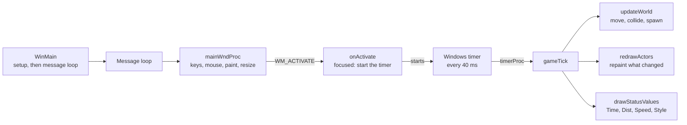

# SkiFree internals

Everything here was read from the decompiled code of `ski32.exe` 1.04 (SHA-256 `3572d375…8cf0ff35`), with the names from [`names.tsv`](../names.tsv). Run `python run.py` and open `out/decompiled.c` to check any of it. For how we got here, read the [learning guide](LEARN.md).

## Layout of the executable

| Range | Contents |
| --- | --- |
| `0x401000` – `0x406c80` | The game: 106 functions, all named |
| `0x406cd0` – `0x406cf8` | C runtime helpers: `srand`, `rand` (Microsoft LCG, `* 0x343FD + 0x269EC3`), `atoi` |
| `0x406d83` onward | C runtime startup (the entry point) and library code |

Every `assert` in the game prints `V:\hack\ski32\ski2.c` and a line number, up to line 4,387. The game was written mostly, perhaps entirely, in that one C file.

## How it runs

- `WinMain` parses the command line (`nosound`), allocates the pools, builds the courses, registers two window classes and runs the message loop.
- `SkiMain` is the game window. `SkiStatus` is a separate child window in the corner with Time, Dist, Speed and Style; it has its own window procedure and is moved by `placeStatusWindow` whenever the main window is resized.
- The timer only runs while the window has focus and is not minimized (`onActivate`). Switching to another program pauses the game.
- Only one copy can run: `initWindows` looks for an existing `SkiMain` window and brings it to the front instead.

## Drawing without flicker

The sprites are loaded once into two off-screen sheets, one for sprites up to 32 px wide and one for wider ones, each with a monochrome mask made with `NOTSRCCOPY`. A sprite is drawn by OR-ing its mask onto the back buffer (`SRCPAINT`) and then AND-ing the sprite (`SRCAND`), which makes its white background transparent.

The game never redraws the whole screen. When an object moves, `makeEraseGhost` leaves a copy at the old position flagged as a ghost. `redrawActors` groups overlapping objects, paints each group into a back buffer in depth order, erases the ghosts and copies only the changed rectangles to the window.

## The object ("actor")

Everything on screen is an 80-byte record. There is a pool of 100 (`g_actorPool`), a linked list of live ones (`g_actors`) and a free list (`g_freeActors`).

| Offset | Field | Meaning |
| --- | --- | --- |
| `0x00` | next | Next in the live list |
| `0x04` | ghost | Copy at the previous position, used to erase |
| `0x08` | drawNext | Next object in the same drawing group |
| `0x0c` | placement | The course entry it was spawned from, or 0 if random |
| `0x10` | bitmap (u16) | Sprite number, 1 to 89 |
| `0x14` | spriteInfo | Pointer into `g_sprites`: sheet DC, mask DC, y in the sheet, width, height, area |
| `0x18` | type | See the table below |
| `0x1c` | state | Animation state, 0 to 0x3f; `tbl_stateToBitmap` maps it to a sprite |
| `0x20` | screenRect | Rectangle on screen |
| `0x30` | drawRect | Rectangle of its drawing group |
| `0x40` | x, y, z (shorts) | World position; z is height during a jump |
| `0x46` | vx, vy, vz (shorts) | Velocity |
| `0x4c` | flags | 1 drawn, 2 ghost, 4 rect valid, 8 deleted, 0x10 needs redraw, 0x20 image changed, 0x40 ground decal |

World units: the status window shows distance as `y / 16` meters.

## Object types

| Type | What | States | Sprites | Behaviour |
| --- | --- | --- | --- | --- |
| 0 | Skier | `0x00`–`0x15` | 1–22 | See "The skier" |
| 1 | Beginner skier | `0x16`–`0x1a` | 28–32 | Skis slowly; falls over when hit |
| 2 | Dog | `0x1b`–`0x1e` | 33–36 | Runs right with a random wobble. When something bumps into it, it stops and barks; each bark has a 1% chance it pees (yellow snow, sprite 82) before running off, about 1 in 4 per bump |
| 3 | Snowboarder | `0x1f`–`0x26` | 37–44 | Jumps on bumps and ramps, crashes into obstacles. Also jumps off the chairlift |
| 4 | Chairlift chair | `0x27`–`0x29` | 65–67 | Goes up at x = -112 full (65), down at x = -144 empty (67). On the way up, 1 tick in 1,000 a snowboarder jumps off and the chair carries one rider (66) |
| 5–8 | Yeti | `0x2a`–`0x37` | 68–81 | One per edge of the world; see "The yetis" |
| 9 | Tree on fire | `0x38`–`0x3b` | 83–85 | Created when the skier crashes into a dead tree mid-jump |
| 10 | Walking tree | `0x3c`–`0x3f` | 49, 87–89 | Looks like a normal pine (49). Each tick 1% chance to start walking sideways, 10% to stop |
| 11 | Moguls | fixed | 27 | Ground decal; skiing straight down over them bounces you into a small jump and halves your speed |
| 12 | Slalom flag | fixed | 23–26 | Turns green (25) or red (26) as you pass; hitting one halves your speed |
| 13 | Tree | fixed | 49–51, 64 | 6/8 pine, 1/8 dead tree (50), 1/8 tall tree (51). The chairlift towers (64) are also type 13 |
| 14 | Rock or stump | fixed | 45, 46, 86 | A stump hit while walking uphill becomes a mushroom (86) |
| 15 | Bumps | fixed | 47, 48 | Throw you into a jump with upward speed 4 |
| 16 | Ramp | fixed | 52 | Launches you upward with your current speed |
| 17 | Sign or yellow snow | fixed | 53–63, 82 | Title, version, Start, Finish, course signs |

## The skier

States 0 to 6 are directions: 0 straight down, 1 to 3 turning further left (3 faces left and stops), 4 to 6 the same to the right. `tbl_turnLeft` and `tbl_turnRight` give the next state for each key press; one more press from 3 or 6 gives 7 or 8 (sidestepping), and up from there gives 9 or 10 (walking uphill). State 11 is "OUCH" on the ground, 12 getting up. States 13 to 21 are in the air: 13 a normal jump, 14 and 15 leaning, 16 sideways, 18 to 21 flips. `tbl_landState` says which state each one lands in: only 13, 14 and 15 land on your feet.

`tbl_playerPhysics` holds the top speed per state: 16 straight down, 12 and 6 at the angles, 0 facing sideways, 20 to 24 in the air.

### Controls (`onKeyDown`, `onCharKey`, `onMouseMove`, `onLeftClick`)

| Input | Effect |
| --- | --- |
| Arrows, numeric keypad 1–9 | Turn or set a direction |
| Insert or keypad 0 | Jump: upward speed 2, and forward speed drops by 4 |
| Left click | Jump: upward speed 4, no speed loss. Peaks at height 10 instead of 3 |
| Mouse position | `dirFromMouseGround` turns the pointer position into one of 7 directions |
| Up arrow in the air | Flips |
| F2 | New game |
| F3 | Pause |
| Esc | Minimize |
| Enter | New game, only after the yeti has eaten you |
| `f` | Toggles double speed for the skier and every free-roaming object; yetis and chairlift are unaffected |
| `t`, `r` | Debug: run one tick by hand, redraw |
| `x`, `X`, `y`, `Y` | Debug: nudge the skier 2 pixels |

### Style points (`addStyle`, counted only on the Freestyle course)

| Event | Points |
| --- | --- |
| Jumping over an obstacle | +6 |
| Every tick in an air trick | +2 (state 16), +4 (states 18, 19), +8 (states 20, 21) |
| Every tick walking or sidestepping | -1 |
| Knocking over a beginner or a snowboarder | +20 |
| Bumping the dog | +3 |
| Crashing into a dead tree mid-jump (it catches fire) | +16 |
| Jumping over a burning tree (puts it out) | +1,000 |
| Jumping over a mushroom (picks it up) | +100 |
| Skiing through yellow snow | -16 |
| Crashing into an obstacle | -32 |
| Botched landing | -64, but dead code: `tbl_landState` never produces that state |

## Courses

`buildCourses` lays out each course as a list of placements (36 bytes: position, type, sprite, velocity) sorted by y. `spawnVisible` turns placements into objects as they come near the screen.

| Course | x range | Start to finish (y) | Key in `entpack.ini` | Scored by |
| --- | --- | --- | --- | --- |
| Slalom | -576 to -320 | 640 to 8,640 (40 m to 540 m) | `SS` | Time; each missed gate adds 5 s |
| Freestyle | -160 to 160 | 640 to 16,640 (40 m to 1,040 m) | `FS` | Style points |
| Tree Slalom | 320 to 512 | 640 to 16,640 (40 m to 1,040 m) | `GS` | Time |

`checkSlalom`, `checkFreestyle` and `checkTreeSlalom` detect the start and finish lines with `lerpAtLine`, which interpolates the exact crossing between two ticks so timing does not depend on the frame rate. `showHighScores` keeps the top 10 per course in `entpack.ini`, section `[Ski]`, and shows them with `<-- that's you!` or `<-- try again!`.

## The yetis

`buildCourses` places four yetis, one per edge of the world. Each one chases you only when you cross its line:

| Yeti | Home | Chases when the skier passes |
| --- | --- | --- |
| Type 6, bottom | y = 32,060 | y > 32,000 (2,000 m down, the famous one) |
| Type 5, top | y = -2,060 | y < -2,000 (125 m uphill from the start) |
| Type 7, left | x = -16,060 | x < -16,000 |
| Type 8, right | x = 16,060 | x > 16,000 |

While chasing, the yeti stays within one screen of the skier and moves toward him at up to 16 units per tick sideways and 26 downhill. When it catches him, `handleCollision` deletes the skier and the yeti plays a 3-second eating animation (sprites 76 to 81) before walking off.

## Random objects

Every 60 units the world scrolls, `spawnAtEdge` creates an object at the incoming edge. Its type depends on the zone:

| Open slope (`pickTypeOpenSlope`) | Share |
| --- | --- |
| Tree | 45% |
| Rock or stump | 20% |
| Bumps | 20% |
| Moguls | 5% |
| Walking tree | 5% |
| Ramp | 2% |
| Beginner skier | 2% |
| Dog | 1% |

The course zones use their own tables (`pickTypeSlalomZone`, `pickTypeTreeSlalomZone`, `pickTypeFreestyleZone`). Nothing new is spawned while the total sprite area on screen (`g_totalSpriteArea`) is above a fraction of the visible area.

## Sound

`initWindows` loads nine `WAVE` resources with `loadWave`, and `playSound` plays them with `sndPlaySound(SND_ASYNC | SND_MEMORY)`. But `ski32.exe` contains no `WAVE` resources at all, so every load fails and the game is silent. The `nosound` command-line option skips the loading. Where each slot would have played, from its call sites:

| Slot | Event |
| --- | --- |
| 1 | Crashing into a tree or rock |
| 2 | Hitting bumps or a ramp |
| 3 | Bumping the dog |
| 4 | Landing a jump |
| 5 | A snowboarder jumping |
| 6 | A beginner falling over |
| 7 | The yeti catching the skier |
| 8 | The dog peeing |
| 9 | The yeti chasing |
