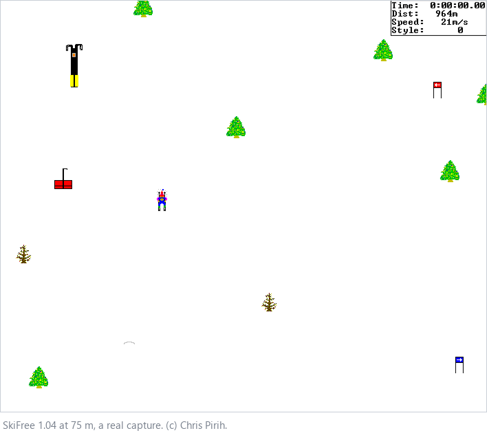
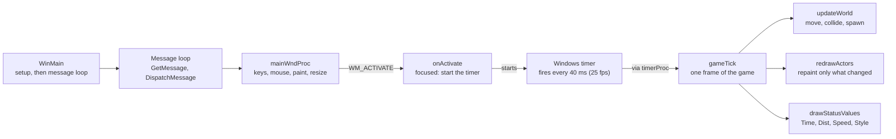
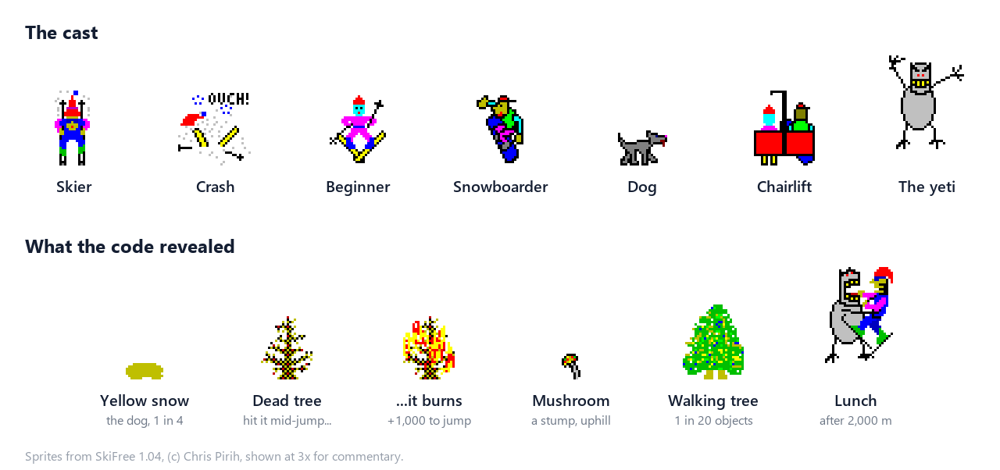
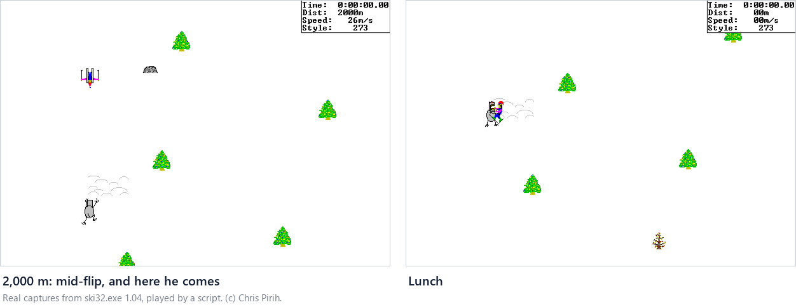

# Reverse Engineering SkiFree: A Learning Guide

*Leer en español: [APRENDE.md](APRENDE.md)*

## How to use this guide

This guide takes SkiFree's 118 KB executable from raw bytes to readable C with every game function named, and teaches the method so you can repeat it on any old Windows program.

It is written for programmers who can read C but have never opened a disassembler. No assembly is required: the decompiler does that part, and your job is to recover the meaning.

By the end you will be able to:

1. Identify an unknown `.exe`: compiler, date, packing, what it asks Windows for.
2. Pull its text, images and tables out into normal files.
3. Run Ghidra from the command line and export the decompiled C.
4. Read that C, name every function and global, and document how the program works.
5. Check your reading against an independent source, and catch your own mistakes.

Every step has three parts: what we did, why it works, and something to try yourself. The scripts live in this repository, and `python run.py` reproduces everything. The game's internals are documented in [INTERNALS.md](INTERNALS.md).

The analysis was done with Claude Code, an AI coding agent, directed by the author. Every claim about the game was re-checked against the decompiled code before it went into this guide, and the mistakes we made along the way are listed in Step 4.

## What is SkiFree?



SkiFree is a tiny skiing game for Windows, written in 1991 by Chris Pirih, a Microsoft programmer, on his home computer. Microsoft licensed it and shipped it in Microsoft Entertainment Pack 3 for Windows 3.0 in October 1991. You ski down an endless slope dodging trees, rocks, dogs and other skiers, on three courses: slalom, tree slalom and freestyle. Keep going far enough and the Abominable Snow Monster eats you.

The author lost the source code around 1993 and found the source of version 1.03 in 2005. He compiled a real 32-bit version from it and released 1.04 in October 2005. That 1.04 build is the one this guide takes apart, and he still gives it away at [ski.ihoc.net](https://ski.ihoc.net/).

## The big picture

Reverse engineering means recovering how a program works from the compiled program alone. Compiling throws away names, comments and types, but keeps the logic, the constants, the text and every call the program makes to the operating system. Your job is to put the meaning back.

There are four levels of "reviving" old software, and each one costs much more than the last:

| Level | What you do | Typical effort |
| --- | --- | --- |
| 1. Run it | Use an emulator or compatibility layer: DOSBox, Wine, Windows compatibility mode | Minutes |
| 2. Patch it | Change a few bytes to skip a CD check, a version check or a broken timer | Hours to days |
| 3. Understand it | Decompile, name everything, document how it works | Days to weeks |
| 4. Rebuild it | Write C that compiles back into the exact same bytes, so it can be ported | Months |

This project is a complete level 3. Level 4 is what the famous decompilation projects did for Super Mario 64 and Diablo.

Four filters pick a good target:

- **Abandoned.** Nobody sells or maintains it anymore.
- **Not done yet.** Search GitHub first. We skipped this check and found out later that SkiFree already had a published decompilation.
- **Small.** An executable of 200 KB to 2 MB can be finished. One of 50 MB is a project of years.
- **32-bit if possible.** Windows 95 and later. Decompilers understand 32-bit Windows code very well; 16-bit and DOS code cost about twice as much at every step.

SkiFree passes every filter except the second, and that turned out to be useful: a published decompilation is an answer key you can check your own reading against, which is exactly what a first project needs.

## Step 0: Get the binary legally, and pin it

SkiFree's author, Chris Pirih, gives the game away on his own site, [ski.ihoc.net](https://ski.ihoc.net/). We used the 32-bit version 1.04, `ski32.exe`, 118,784 bytes.

**What we did.** Downloaded it from the author's site and recorded its SHA-256 hash:

```
3572d3757638bc1ae388c3d007ba59ba1f370911901e2a35d2f1297e8cf0ff35  ski32.exe
```

**Why it matters.** Every address in this guide, like `0x401000` or `0x4052d0`, refers to that exact file. A different build of the same game moves every function, and nothing here will line up. The hash is how you and anyone repeating your work know you started from the same bytes.

Two rules that keep a project like this clean:

- **Never put the binary in your repository.** Link to where it can be downloaded legally and check the hash. Our `run.py` downloads it from the author's site and refuses to continue if the hash does not match.
- **Don't commit what you extract from it either.** The repo publishes the method and the names, and you regenerate the sprites and the decompiled C on your machine. The only exception is a few screenshots and sprites in the docs, credited to the author, so readers can see the game.

**Try it.** On Windows, `certutil -hashfile ski32.exe SHA256`. On Linux or macOS, `sha256sum ski32.exe`.

## Step 1: Identify the executable before you disassemble it

A Windows `.exe` is a PE file (Portable Executable), and it carries its own spec sheet in its headers. Reading them first tells you what you are dealing with in a minute, before any disassembly. Script: [`scripts/identify.py`](../scripts/identify.py), using the Python library `pefile`.

**What the headers said about SkiFree:**

| Field | Value | What it tells you |
| --- | --- | --- |
| Machine | i386 | 32-bit Intel code |
| Subsystem | Windows GUI, minimum OS 4.0 | A windowed program for Windows 95 or later |
| Timestamp | 2 Oct 2005, 22:01 UTC | When it was linked; matches the author's story of recompiling it in 2005 |
| Linker version | 6.0 | Visual C++ 6 |
| Image base / entry point | `0x400000` / `0x406d83` | Where it loads in memory, and where execution starts |

**The Rich header.** Microsoft's linker hides an undocumented list of the tools that built each object file between the DOS stub and the PE header. SkiFree's says: 27 objects from the Visual C++ 6 C compiler, 1 from the C++ compiler, 10 from the MASM assembler, plus the resource compiler. Conclusion: the game is written in C, not C++. The C++ and assembly objects belong to Microsoft's C runtime library, which is linked into every program.

**Sections and entropy.** An executable is split into sections. Measuring the entropy of each one tells you whether it is packed or encrypted before you waste a day on it:

$$H = -\sum_{i=0}^{255} p_i \log_2 p_i$$

Here p is how often each byte value appears. The result runs from 0 (one value repeated) to 8 bits per byte (perfectly random). Normal machine code sits around 5 to 6.5. Above 7 means compressed or encrypted, and you must unpack it first.

| Section | Holds | Size | Entropy |
| --- | --- | --- | --- |
| `.text` | Machine code | 34 KB | 6.29 |
| `.rdata` | Constants and the import table | 4 KB | 3.10 |
| `.data` | Global variables | 3 KB | 1.36 |
| `.rsrc` | Resources: images, icons, text | 62 KB | 3.75 |

Nothing is packed. And more than half the file is pictures: the actual program is 34 KB.

**Imports tell the story.** The import table lists every function the program borrows from Windows. You can describe the game from it without reading a single instruction:

- `BitBlt`, `CreateCompatibleDC`, `CreateCompatibleBitmap`: it draws with plain GDI, no DirectX.
- `SetTimer`, `KillTimer`, `GetTickCount`: the game clock is a Windows timer.
- `GetPrivateProfileStringA`, `WritePrivateProfileStringA`: it saves something in an `.ini` file. High scores, most likely.
- `FindWindowA`, `OpenIcon`: it probably prevents two copies from running at once.
- `LoadBitmapA`, `FindResourceA`, `LockResource`: sprites come from the file's own resources.
- `sndPlaySoundA`: one way to play a sound. Remember this one.
- `HeapAlloc`, `GetEnvironmentStrings` and friends: the C runtime. Noise you learn to ignore.

**Try it.** Run `python scripts/identify.py` on another program, for example `C:\Windows\System32\notepad.exe`, and compare: which sections, which DLLs, which entropy?

## Step 1b: Strings and resources

Text and pictures inside the file are the cheapest clues you will ever get. Scripts: [`scripts/identify.py`](../scripts/identify.py) writes every string, [`scripts/extract_resources.py`](../scripts/extract_resources.py) writes the resources.

**Strings.** Searching for runs of 5 or more printable characters, in both ASCII and UTF-16, finds 444 of them. Most are noise, and recognizing noise is a skill:

- Short gibberish like `L$ RPQ` is machine code that happens to look like text.
- Runs like `wwwwwwp` are pixels from the bitmaps.
- `R6002 - floating point not loaded` and friends are the C runtime's error messages.

The ones that matter are few, and each is an anchor you will use in Step 3:

- `SkiMain` and `SkiStatus`: names of window classes. The game has two windows.
- `entpack.ini`: the settings file of the old Windows Entertainment Pack. This is where high scores go.
- `V:\hack\ski32\ski2.c` and `Assertion Failed`, `%s line %u`: the author left his debug checks in. Every check prints the original source file name and its line number.
- `nosound`: a command-line option.
- `Whoa, like, can't load bitmaps!  Yer outa memory, duuude!`: an error message with personality.

**Resources.** Windows programs keep pictures, icons and translatable text in a resource section, organized by type and numeric ID. SkiFree has four types: 89 bitmaps, 6 icons, 2 icon groups and 2 string tables.

- **String tables** come in blocks of 16. The string's ID is `(block - 1) * 16 + position`. Decoding them gives 17 strings with their IDs: 1 is `SkiFree`, 2 is `Ski Paused ... Press F3 to continue`, 3 to 6 are `Time:`, `Dist:`, `Speed:`, `Style:`, 15 is `High Scores`. The IDs matter, because the code asks for strings by number.
- **Bitmaps** are stored as a BMP file minus its 14-byte file header. Write those 14 bytes back and every one opens in any image viewer. Then put all 89 on one numbered contact sheet. That sheet answered more questions in Step 3 than anything else.

Notice what is missing: there are no sound resources at all. Keep that in mind until the secrets section.

**Try it.** Run `python scripts/extract_resources.py` and open `out/sprites/contact_sheet.png`. Before reading any code, guess what bitmaps 82 and 83 to 85 are for.

## Step 2: Ghidra without the GUI

[Ghidra](https://ghidra-sre.org/) is the NSA's free disassembler and decompiler. Most tutorials use its window; we ran it headless, from the command line, so every result lands in a text file you can search, diff and commit.

**What we did.** One call to Ghidra's `analyzeHeadless` imports `ski32.exe` into a project, runs every automatic analyzer, and then runs our script [`ghidra/ExportDecomp.java`](../ghidra/ExportDecomp.java). The script writes three files:

- `out/raw_decompiled.c`: the C that Ghidra reconstructs for every function.
- `out/raw_functions.tsv`: every function with its address, size, how many functions call it and how many it calls.
- `out/strings_xref.tsv`: every string, and which functions use it.

**What the automatic analysis does for you:**

1. Starts at the entry point and follows every jump and call to separate code from data.
2. Finds where each function begins and ends, and builds the call graph.
3. Recognizes C runtime functions by their byte signatures, so `malloc`, `strlen` and `memset` arrive already named.
4. Applies the Win32 headers: that is why the call to `CreateWindowExA` arrives with its parameters named `lpWindowName`, `dwStyle` and so on.

**The result for SkiFree:** 162 functions, all decompiled with zero failures, and almost all named `FUN_00401060` with variables like `iVar3`. That is the raw material for Step 3.

**Where the game ends and the runtime begins.** The linker puts the program's own code first and the library after it. SkiFree's own functions run from `0x401000` to `0x406c80`: 104 found by Ghidra, plus 2 more we found by hand in Step 3. From `0x406cd0` on it is Microsoft's C runtime: `srand`, `rand`, `atoi`, then the startup code at the entry point that eventually calls `WinMain`. You can spot `rand` without any signature: it multiplies by `0x343FD` and adds `0x269EC3`, the constants of Microsoft's random number generator. Magic constants like these identify library code on sight.

**Why headless is worth it.** The whole pipeline becomes one command that anyone can rerun from scratch. It also means a script, a CI job or an AI agent can drive Ghidra, which is how this project was done.

**Try it.** Install Ghidra and Java 21, set `GHIDRA_HOME`, and run `python run.py`. Then open `out/raw_functions.tsv` and sort by the "callers" column: which functions are called the most, and which ones are never called at all?

## Step 3: Read the decompiled code and name everything

This is the real reverse engineering: turning 106 functions called `FUN_...` into a program you understand. The trick is to never start in the middle. Work from the outside in, using clues you already have, and name each function the moment you understand it.

Here is one function before and after. Same code; only the names changed:

```c
// Before: straight out of Ghidra
void FUN_00401000(void) {
  DWORD DVar1 = GetTickCount();
  DAT_0040c5f4 = DVar1 - DAT_0040c698;
  DAT_0040c708 = DAT_0040c698;
  DAT_0040c698 = DVar1;
  FUN_00401e50();
  FUN_00401060(DAT_0040c63c, &DAT_0040c6b0);
  DAT_0040c610 = 1;
  if (0x147 < (int)(DAT_0040c698 - DAT_0040c5dc)) FUN_00401b80(DAT_0040c6cc);
}

// After: our names applied
void gameTick(void) {
  DWORD DVar1 = GetTickCount();
  g_frameMs = DVar1 - g_nowMs;
  g_prevMs = g_nowMs;
  g_nowMs = DVar1;
  updateWorld();
  redrawActors(g_hdcMain, &g_clientRect);
  g_redrawBudget = 1;
  if (0x147 < (int)(g_nowMs - g_statusDrawnMs)) drawStatusValues(g_hdcStatus);
}
```

The order that worked, from easiest clue to hardest:

1. **Anchors from strings.** `out/strings_xref.tsv` says which function uses each string. The one that uses `SkiMain` and `SkiStatus` registers the windows: `initWindows`. The one that uses `entpack.ini` saves high scores: `showHighScores`. The one that formats `%s line %u` and shows `Assertion Failed` is the author's `assert`, and the 45 functions that call it are all game code.
2. **Anchors from imports.** The function that calls `SetTimer` starts the clock. The one that calls `BitBlt` inside a loop over 89 bitmaps loads the sprites. The one that calls `GetTickCount` and then two big functions is the game tick, shown above.
3. **Windows message numbers.** A window procedure is a big `switch` on message numbers. Learn the common ones and you can name every handler at once:

    | Number | Message | SkiFree's handler |
    | --- | --- | --- |
    | `0x0001` | `WM_CREATE` | `initGraphics` |
    | `0x0005` | `WM_SIZE` | `onMainSize` |
    | `0x000F` | `WM_PAINT` | `onMainPaint` |
    | `0x0100` | `WM_KEYDOWN` | `onKeyDown` |
    | `0x0102` | `WM_CHAR` | `onCharKey` |
    | `0x0200` | `WM_MOUSEMOVE` | `onMouseMove` |
    | `0x0201` | `WM_LBUTTONDOWN` | `onLeftClick` |

    Inside `onKeyDown` the same trick works with virtual key codes: `0x25` to `0x28` are the arrow keys, `0x60` to `0x69` the numeric keypad, `0x71` is F2 and `0x72` is F3.
4. **Functions nobody calls.** Sort by callers. A function with zero callers is invoked by Windows through a pointer: a window procedure, a timer callback. Two of SkiFree's most important functions, the main window procedure at `0x405800` and the timer callback at `0x4047c0`, were not detected as functions at all, because the code only stores their address. We created them by hand. Always check for this.
5. **Data tables.** Much of a game's behavior lives in tables, not code. [`scripts/dump_tables.py`](../scripts/dump_tables.py) prints them: which bitmap each animation state uses, which state comes next when you press left or right, the top speed for each state. Without the tables you cannot tell that object type 10 is a tree.
6. **The sprite sheet.** When the code said "create an object of type 0x11 with bitmap 82", the contact sheet said bitmap 82 is a patch of yellow snow. Pictures resolve what code alone cannot.
7. **Structures from offsets.** The same expressions keep appearing: `*(short *)(p + 0x40)`, `*(uint *)(p + 0x4c)`. That is a struct accessed field by field. Collect the offsets, figure out each field from how it is used, and write the struct down:

    | Offset | Field | Meaning |
    | --- | --- | --- |
    | `0x00` | next | Next object in the list |
    | `0x04` | ghost | Copy at the previous position, used to erase |
    | `0x10` | bitmap | Sprite number, 1 to 89 |
    | `0x18` | type | Skier, dog, yeti, tree and so on |
    | `0x1c` | state | Animation state, 0 to 63 |
    | `0x40` | x, y, z | Position in the world; z is height in a jump |
    | `0x46` | vx, vy, vz | Velocity |
    | `0x4c` | flags | Drawn, ghost, deleted, needs redraw, ground decal |

**The naming loop.** Names go in [`names.tsv`](../names.tsv), three columns: `fn`, `dat` or `create`, then the address, then the name. [`ghidra/ApplyNames.java`](../ghidra/ApplyNames.java) applies them to the analyzed project, creates any missing functions, and exports `out/decompiled.c` again. Each pass makes the next one easier, because every name you add makes the code around it readable. We ended with 109 functions named (106 of the game, 3 runtime helpers) and 120 globals.



The map you end up with. `WinMain` sets everything up and hands control to Windows. From then on a 40 ms timer runs one frame per tick, and it only runs while the window has focus: switch to another program and the game pauses itself.

**Try it.** Pick one function you have not named yet in `out/decompiled.c`, read it, and write its name in `names.tsv`. Run `python run.py --names-only` and watch it spread through every function that calls it.

## Step 4: Check your reading, and learn from the mistakes

Only after all the names were in did we open the answer key: Eric Fry's [skifree_decomp](https://github.com/yuv422/skifree_decomp), a decompilation of the same `ski32.exe` published in September 2022. Looking earlier would have turned the exercise into copying.

**What matched.** The 18 object types, 0 to 17, match his one for one, in the same order: player, beginner, dog, snowboarder, chairlift, four yetis, tree on fire, walking tree, moguls, slalom flag, tree, rock or stump, bump, jump, sign. Several function names came out identical without having seen his. In the functions we compared, the two readings agree.

| Address | Our name | His name | Note |
| --- | --- | --- | --- |
| `0x4052d0` | `initWindows` | `initWindows` | Identical |
| `0x401240` | `assertFailed` | `assertFailed` | Identical |
| `0x401000` | `gameTick` | `timerUpdateFunc` | Same idea |
| `0x403a00` | `handleCollision` | `handleActorCollision` | Same idea |
| `0x401350` | `deleteActor` | `actorSetFlag8IfFlag1IsUnset` | He names the mechanism, we name the intent |
| `0x403430` | `applyPhysics` | `updateActorVelMaybe` | He marks doubt with "Maybe" |
| `0x402e30` | `lerpAtLine` | `FUN_00402e30` | He left it unnamed |
| `0x4046e0` | `spawnVisible` | `FUN_004046e0` | He left it unnamed |

Both styles are valid. Naming the mechanism is safer when you are unsure; naming the intent reads better once you are sure.

**The mistakes we made, and what each one teaches.** None of these were caught by the reference. All of them were caught by going back to the code with one specific claim in hand.

1. **We picked a target without searching GitHub first.** SkiFree had been decompiled years before. Lesson: the "not done yet" filter is a search, not a feeling.
2. **We computed file offsets by hand.** Our first table dump assumed where `.rdata` starts in the file, got it wrong, and printed machine code as if it were tables. Lesson: let `pefile` convert addresses to file offsets (`get_offset_from_rva`). Never do that arithmetic yourself.
3. **We over-read the dog.** Our first write-up said the dog stops at random and pees 1% of the time. Re-reading the state machine showed it only stops after you bump into it, and the 1% applies on each bark, which works out to about one chance in four per bump. Lesson: a probability in the code is per tick or per event; work out what it means for the player before you write it down.
4. **We over-read the burning tree.** We first wrote that crashing into a dead tree sets it on fire. The condition is stricter: only if you hit it in the middle of a jump. Lesson: read every branch of the `if`, not the first one.
5. **We wrote a date from memory.** We said the reference was from 2023. GitHub says September 2022. Lesson: every date and number gets checked at its source.
6. **We drew the code boundary too late.** We first said the game's code ran up to `0x406cf8`. The last three functions before the entry point are the runtime's `srand`, `rand` and `atoi`. Lesson: magic constants are the fastest way to spot library code.

The general rule: write the claim, then go find the exact line of code that proves it. If you cannot point to the line, it is a guess, and it stays out of the write-up.

## What we found inside SkiFree

The famous facts hold up: the yeti comes for you after 2,000 meters, and the F key doubles your speed. The code also shows things most players never knew. Every row below was checked against the decompiled function named in the last column. The full detail is in [INTERNALS.md](INTERNALS.md).

| What | What the code actually does | Function |
| --- | --- | --- |
| No released version has ever made a sound | Version 1.04 has a complete sound system with 9 sound slots and a `nosound` option, but the loader looks for `WAVE` resources and the file has none. The 1991 original doesn't even reference Windows' sound library. The author says his unreleased Version 2 had sound. | `initWindows`, `loadWave` |
| There are four yetis, not one | One waits at each edge of the world. Ski 2,000 m down, 125 m back uphill, or 1,000 m to either side, and the yeti on that edge chases you. | `buildCourses`, `updateYeti` |
| Mouse jumps are three times as high | A click launches at upward speed 4. The Insert key launches at 2 and also cuts your forward speed by 4. With gravity at 1 per tick, the click peaks at height 10 instead of 3 and stays airborne about twice as long. | `onLeftClick`, `onKeyDown` |
| F doubles your speed | The F key toggles a flag that applies velocity twice per tick to the skier and every free-roaming object. The yetis and the chairlift run on separate code and keep their normal speed. | `onCharKey`, `applyVelocity` |
| The dog | Bump into the dog and it stops and barks. Each bark has a 1% chance that it pees, leaving yellow snow (bitmap 82) before it runs off: about 1 in 4 per bump. Skiing through yellow snow costs 16 style points. | `updateDog`, `handleCollision` |
| Trees catch fire | Crash into a dead tree in the middle of a jump and it bursts into flames. Jump over the burning tree for 1,000 style points, and the fire goes out. | `handleCollision`, `updateFire` |
| Stumps become mushrooms | Walk uphill into a tree stump: you still fall, but it turns into a mushroom. Jump over the mushroom for 100 style points. | `handleCollision` |
| Some trees walk | 1 in 20 random objects on the open slope looks exactly like a pine, until it starts walking sideways. | `pickTypeOpenSlope`, `updateWalkingTree` |
| A penalty that never fires | Landing code subtracts 64 style points for a botched landing, but the landing table never produces that state. Dead code. | `updateActor` |
| Rude points | In Freestyle, knocking over a beginner earns 20 style points, a snowboarder 20, the dog 3. | `handleCollision`, `addStyle` |
| Slalom penalty | Each missed gate turns red and adds 5 seconds to your time. | `checkSlalom` |
| High scores | Top 10 per course, saved in `entpack.ini` under `[Ski]` with keys `SS`, `FS` and `GS`. | `showHighScores` |
| Debug keys shipped | `t` runs one tick by hand, `r` redraws, and `x`, `X`, `y`, `Y` nudge the skier 2 pixels. | `onCharKey` |
| The original source | Every assert names the same file, `V:\hack\ski32\ski2.c`, with line numbers up to 4,387. The game was written mostly, maybe entirely, in that one file. | `assertFailed` callers |





The yeti captures come from the real game. [`scripts/capture_gameplay.py`](../scripts/capture_gameplay.py) runs it off-screen, starts its timer with a fake `WM_ACTIVATE`, presses keys with `PostMessage`, and reads the skier's position from memory at the address of `g_player`, one of the globals we named. Knowing the program's internals is what makes it scriptable.

Two engineering details worth stealing. The game runs at 25 frames per second, from a 40 ms Windows timer. And it never redraws the whole screen: when something moves, it leaves behind a "ghost" copy at the old position that gets erased, and only the rectangles that changed are painted. That is why it ran smoothly on a 386.

## Glossary

| Term | Meaning |
| --- | --- |
| Assert | A check the programmer leaves in the code that complains if something impossible happens. Release builds usually remove them; SkiFree kept them, with file name and line number. |
| Calling convention | The rule for how arguments are passed to a function. SkiFree uses `__fastcall`: the first two arguments go in registers, which is why Ghidra labels many functions that way. |
| CRT (C runtime) | Microsoft's standard C library (`malloc`, `rand`, startup code), linked into every program. Recognize it and skip it. |
| Dead code | Code that can never run, often left over from an earlier version. |
| Decompiler | Turns machine code into C-like code. Ghidra includes one. Its output is correct but has no meaningful names. |
| Disassembler | Turns machine code into assembly instructions, one per line. The decompiler works on top of it. |
| Entropy | How random a block of bytes is, from 0 to 8 bits per byte. Above 7 means compressed or encrypted. |
| Entry point | The address where execution starts. For a C program it is the runtime's startup code, which later calls `WinMain`. |
| Headless | Running a tool from the command line with no window, so it can be scripted and repeated. |
| Import table | The list of functions a program borrows from Windows DLLs. Reading it is the fastest way to learn what a program does. |
| LCG | Linear congruential generator, the simple random number formula `seed = seed * a + c`. Its constants identify which library it came from. |
| Magic constant | A distinctive number in code, like `0x343FD`, that identifies an algorithm or library on sight. |
| Matching decompilation | Source code that compiles back into the exact original bytes. The gold standard, and much more work than naming. |
| PE (Portable Executable) | The file format of Windows `.exe` and `.dll` files: a DOS stub, headers, then sections. |
| Resource | Data stored inside an executable: bitmaps, icons, strings, sounds, organized by type and ID. |
| Rich header | An undocumented block Microsoft's linker writes, listing which tool versions built the program. |
| ROP (raster operation) | The code that tells `BitBlt` how to combine pixels. SkiFree ORs a mask onto the scene, then ANDs the sprite, which makes the sprite's white background transparent. |
| Section | A named region of the executable: `.text` for code, `.data` for globals, `.rsrc` for resources. |
| Struct offset | A field accessed as `*(short *)(p + 0x40)`. Collect the offsets and you can rebuild the struct. |
| Virtual key code | The number Windows uses for each key: `0x25` is the left arrow, `0x71` is F2. |
| Window procedure (WndProc) | The function Windows calls with every message for a window: paint, key pressed, mouse moved. |
| Xref (cross-reference) | A place in the code that uses a given function, string or variable. Following xrefs is most of reverse engineering. |

## Exercises

Each exercise uses only what this guide covered. Work on a copy of `ski32.exe`, never the original.

**Easy**

- [ ] Run `scripts/identify.py` on `C:\Windows\System32\notepad.exe`. Which DLLs does it import that SkiFree does not, and what does that tell you about each program?
- [ ] Read `formatTime` in `out/decompiled.c`. Why does it divide by `0x3c` twice, and what does `% 1000 / 10` produce?
- [ ] Find every call to `playSound`. Make a list of the nine moments that would have made a noise if the sounds had been included.

**Medium**

- [ ] Patch the game clock. `resetGame` stores `0x28` (40 ms) in `g_timerIntervalMs`. Find that instruction's bytes in the file, change the value to 20 ms, and run the copy. What happens to the speed of the game, and why does the race timer still read correctly?
- [ ] Make the yeti come at 500 m instead of 2,000 m. `updateYeti` compares the skier's position with 32,000 (`0x7d00`). Which value do you need, and why?
- [ ] Name the globals that are still called `DAT_...` in `out/decompiled.c`, add them to `names.tsv` and rerun.

**Hard**

- [ ] Define the object struct from Step 3 in Ghidra's Data Type Manager and apply it to the functions that take an object. `*(short *)(p + 0x40)` becomes `p->x` everywhere. We did not do this, and it is the single biggest readability gain left.
- [ ] Pick your own target that passes the four filters, and run Steps 0 to 2 on it.

## Where to go next

The next step up is level 4: source code that compiles back into the exact original bytes. That means guessing every variable's type, the order of the functions in the source file and the compiler flags, then comparing your build against the original instruction by instruction. Eric Fry's repo shows what that looks like for this same game.

The next target we have in mind is Hover!, the hovercraft capture-the-flag game from the Windows 95 CD: 32-bit, small, much loved, and with no public decompilation that we know of. Search GitHub before you start, as Step 4 taught us.

Tools worth knowing:

- [Ghidra](https://ghidra-sre.org/): everything in this guide.
- [x64dbg](https://x64dbg.com/): a debugger, to watch a 32-bit program run and confirm what the static reading suggests.
- [decomp.me](https://decomp.me/): a website for matching decompilation, where you compare your C against the original assembly.
- [pefile](https://github.com/erocarrera/pefile): the Python library behind Steps 1 and 1b.

Reading:

- *Reverse Engineering for Beginners* by Dennis Yurichev, free at [beginners.re](https://beginners.re/): how C turns into assembly, compiler by compiler.
- *The Ghidra Book* by Chris Eagle and Kara Nance (No Starch Press): the reference for scripting Ghidra, which is what made the headless pipeline possible.
